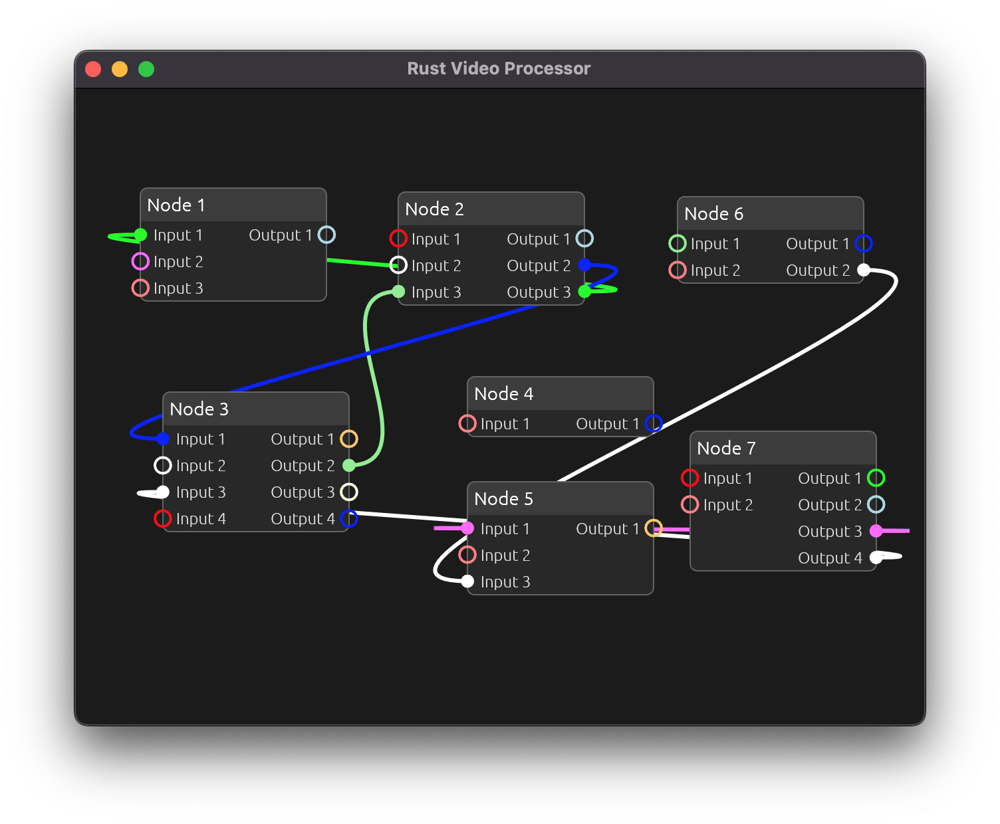

# Rust Video Processor

A blueprint-style UI for processing videos via external tools like ffmpeg/mkvmerge/etc.

## Current progress

## License

Copyright &copy; 2026 noob247365

This project is licensed under the **GNU General Public License v3.0 or later** (`GPL-3.0-or-later`).
You can redistribute it and/or modify it under the terms of the GNU General Public License as published by the Free Software Foundation, either version 3 of the License, or any later version.

See [LICENSE](LICENSE) for the full text.
